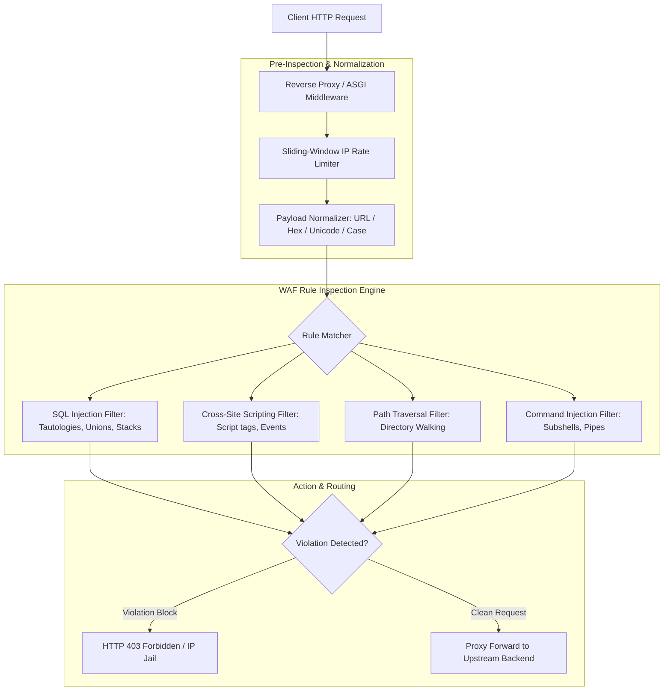

# Mini Web Application Firewall (`mini-waf`)

Modular Reverse-Proxy and ASGI Middleware Web Application Firewall (WAF) with Rule Compilation, Attack Mitigation, and Rate Limiting.

[](https://github.com/Krish9800/mini-waf/actions)
[](LICENSE)
[](https://www.python.org/)
[](https://www.starlette.io/)
[](https://typer.tiangolo.com/)

---

## Overview & Problem Statement

Web applications face continuous automated probing for SQL injection (SQLi), Cross-Site Scripting (XSS), Path Traversal (`../`), and Remote Code Execution (RCE). Enterprise cloud WAFs can be expensive and obscure the underlying inspection mechanics.

**Mini WAF** is a lightweight, pure-Python Web Application Firewall designed to operate either as an inline reverse proxy or as pluggable ASGI middleware. It normalizes HTTP request streams (decoding URL encoding, HTML entities, and multi-byte representations), matches patterns against modular rule sets, tracks client reputation, and blocks malicious requests before they reach upstream application servers.

---

## Architecture & Data Flow



---

## Verified Features

- **Dual Deployment Modes:** Operates as a standalone reverse proxy forwarding to upstream services, or as native ASGI middleware embedding directly into FastAPI/Starlette applications.
- **Payload Normalization:** Decodes nested URL percent-encoding, HTML numeric entities, double-URL encoding, and mixed casing to resist WAF evasion techniques.
- **Core Attack Detection Rules:**
  - SQL Injection (Tautologies `' OR '1'='1`, `UNION SELECT`, stacked queries, blind sleep payloads).
  - Cross-Site Scripting (`<script>`, `javascript:`, DOM event handlers `onload=`, `onerror=`).
  - Path Traversal & LFI (`../`, `..\`, null-byte terminators `%00`, encoded `/etc/passwd`).
  - Command Injection (Shell metacharacters `;`, `|`, `&`, `$(...)`, `` `...` ``).
- **IP Reputation & Dynamic Jailing:** Temporarily blocks repeated malicious source IPs with automatic release timers.
- **Dual Interface:** Typer CLI for rule testing and unjailing, plus a FastAPI administrative API.

---

## Technology Stack

- **Runtime:** Python 3.12+
- **ASGI Framework:** Starlette & FastAPI
- **HTTP Client:** HTTPX (for reverse-proxy forwarding)
- **Data Validation:** Pydantic v2
- **CLI Framework:** Typer & Rich
- **Quality Gates:** Pytest, Ruff, Mypy Strict, Bandit

---

## Requirements & Installation

```bash
# Clone the repository
git clone https://github.com/Krish9800/mini-waf.git
cd mini-waf

# Create and activate virtual environment
python3 -m venv .venv
source .venv/bin/activate

# Install dependencies
pip install -e .
```

---

## Verified Usage Examples

### 1. Command-Line Interface (CLI)

```bash
# List all active WAF inspection rules
miniwaf rules

# Test a suspicious payload against active filters
miniwaf test "1' UNION SELECT username, password FROM users--"

# Test an XSS payload
miniwaf test ""

# Release a temporarily jailed client IP
miniwaf unjail 192.168.1.50
```

### 2. Running as a Reverse Proxy

```bash
# Start WAF reverse proxy forwarding to upstream backend on port 8080
uvicorn miniwaf.proxy.server:app --host 127.0.0.1 --port 8000
```

---

## Testing & Quality Gates

```bash
# Run unit and rule evaluation tests
pytest --cov=miniwaf --cov-report=term-missing

# Linting and static analysis
ruff check .
ruff format --check .
mypy src/miniwaf
```

---

## Security Model & Threat Boundaries

- **Inline Protection:** Malicious payloads are intercepted and terminated at the proxy boundary; upstream backends never process malicious requests.
- **Fail-Safe Design:** If an internal rule parsing exception occurs, the system defaults to safe logging rather than exposing server tracebacks.
- **Normalization Boundaries:** While normalization handles standard evasions, novel zero-day parser differential exploits in upstream web frameworks require defense-in-depth parameterized database queries.

---

## Limitations & Known Issues

- **Streaming Payloads:** Very large multi-part file uploads (>100MB) bypass deep regex inspection to avoid memory exhaustion and are evaluated by header boundaries.
- **WebSocket Inspection:** Full duplex WebSocket frame payload inspection is planned for the next minor release.

---

## License & Responsible Use

This project is licensed under the **MIT License** — see the [LICENSE](LICENSE) file for details.

> [!NOTE]
> Designed for defensive web application protection, application security research, and WAF evaluation.
