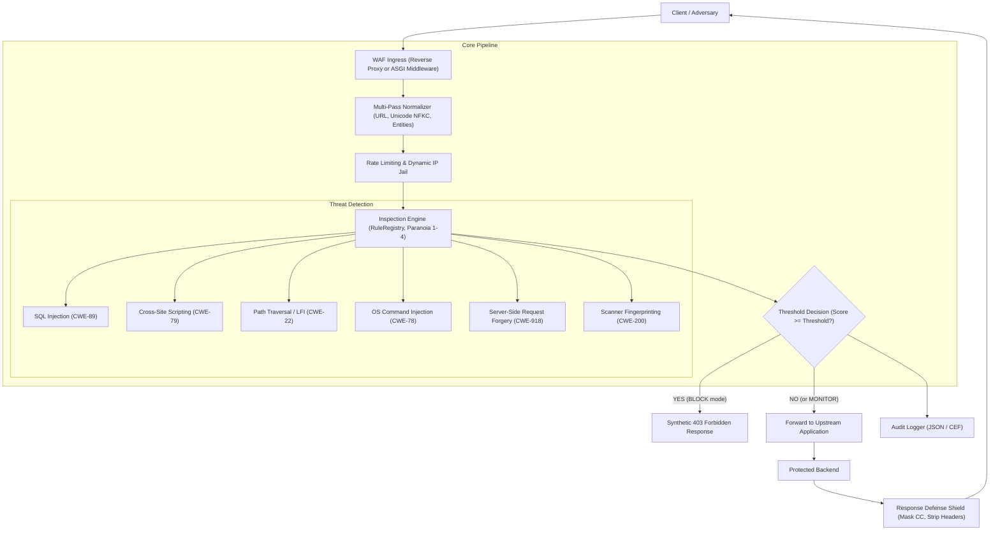

# Architecture Documentation: Mini Web Application Firewall (`mini-waf`)

## 1. System Architecture Overview

`mini-waf` is a modular Web Application Firewall designed to operate either as an inline ASGI middleware or as an asynchronous reverse proxy. It inspects Layer 7 HTTP requests and responses, applying multi-pass canonicalization, rate limiting, signature matching, anomaly score evaluation, and egress data leakage mitigation.

## 2. Layered Defensive Subsystems

### 2.1 Multi-Pass Normalization (`miniwaf.core.normalizer`)
- Neutralizes WAF bypass attempts:
  - Recursive URL percentage decoding (dismantles `%252e%252e` double encoding).
  - Unicode NFKC normalization (collapses full-width character homoglyphs like `＜script＞`).
  - HTML entity unescaping (`&lt;`, `&#x3c;`).
  - Path normalization via RFC 3986 dot-segment resolution.
  - Body size clamping (guards against memory exhaustion / decompression bombs).

### 2.2 Signature Detection Engine (`miniwaf.rules`)
- OWASP ModSecurity Core Rule Set inspired signatures.
- Categorized by target (`URI_PATH`, `QUERY_PARAM`, `HEADER`, `COOKIE`, `BODY`, `USER_AGENT`).
- Configurable Paranoia Levels (1 to 4) allow fine-tuning security posture versus false positive tolerance.

### 2.3 Token Bucket Rate Limiter & Dynamic IP Jail (`miniwaf.core.ratelimit`)
- Per-IP sliding token bucket rate limiter.
- Dynamic violation tracking: placing abusive IPs in jail (temporary ban) after repeated security violations.
- Subnet CIDR allowlisting (trusted cloud networks) and permanent blocklisting.

### 2.4 Outbound Egress Shield (`miniwaf.defense.response`)
- Strips technology fingerprinting headers (`Server`, `X-Powered-By`, `X-AspNet-Version`).
- Cloaks HTTP 500 error pages disclosing stack traces or database driver exceptions.
- Card number detection with ISO/IEC 7812 Luhn checksum algorithm and middle-digit masking.

### 2.5 Deployment Topologies
- **Reverse Proxy**: Standalone async proxy service forwarding traffic to upstream backend applications via `httpx`.
- **ASGI Middleware**: Drop-in middleware for FastAPI, Starlette, or Quart web services.
- **REST Control Plane**: FastAPI management service providing telemetry, rule inspection, and unjail controls.
